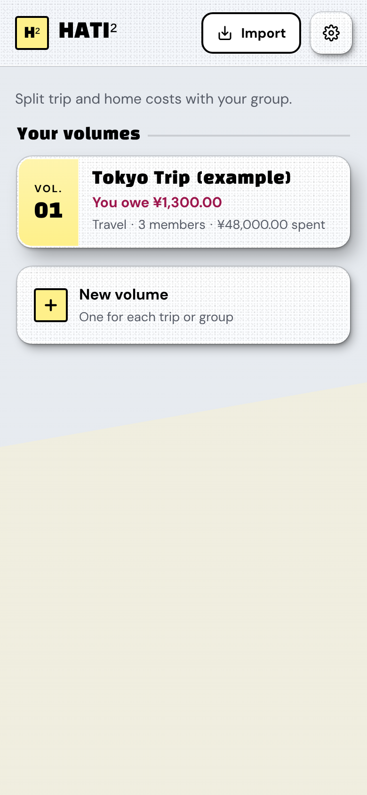
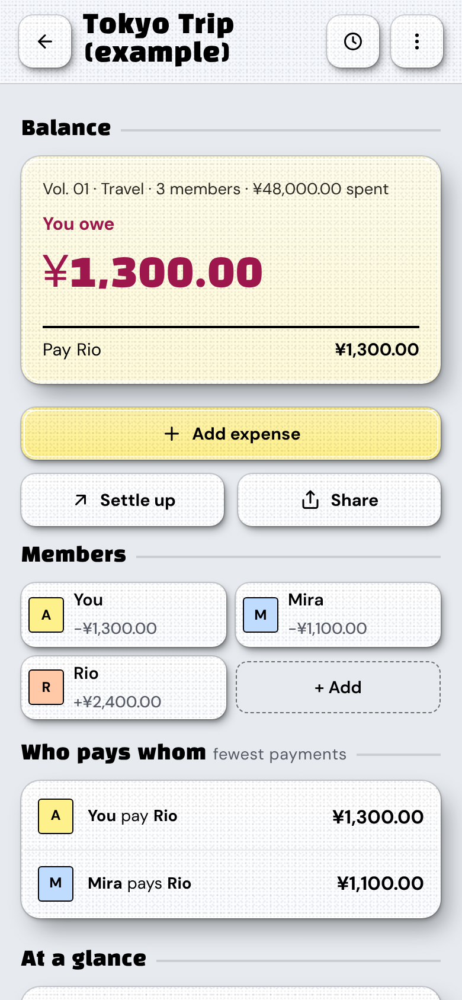
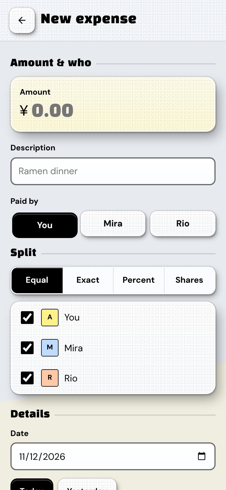
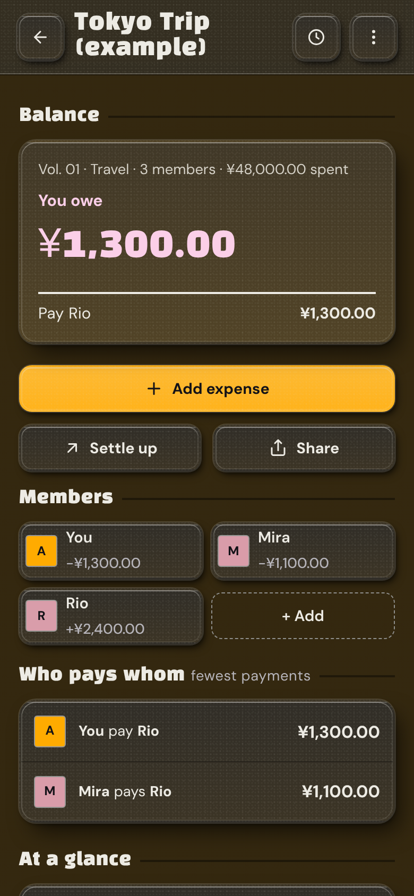

# HATI² (HATI_v2)

> **Handy All-round Transaction Interface, version 2.** Split trip and group expenses offline, settle up, and share a trip between phones. Two apps, one design language: a native Android app and an installable web app that works on Android and iPhone.

-green?style=for-the-badge)


---

## Which app should I use?

| | Native Android app | Web app (`web/` → `docs/app/`) |
|---|---|---|
| Runs on | Android 8.0+ | Android (Chrome) and iPhone (Safari), installed to the home screen |
| Install | Build the APK (see setup) | Open the link, then **Install app** (Android) or **Share → Add to Home Screen** (iPhone) |
| Data | Encrypted Room database (SQLCipher), biometric lock | On the device (`localStorage`), offline via a service worker |
| Sharing | CSV / JSON export | Share code or backup file; importing merges changes from another phone |

**Web app link:** `https://p1xellzxc.github.io/HATI_v2/app/` once GitHub Pages is enabled (Settings → Pages → Deploy from branch → `main`, folder `/docs`). The repository root of the site redirects to the app.

iPhone note: open the link in **Safari**, add it to the home screen **before** entering data, and always open it from the icon. The home-screen app keeps its own storage, separate from Safari.

---

## Screenshots (web app)

<p align="center">
  
  
  
  
</p>

Left to right: volumes as numbered spines, a volume's balance panel (who you pay), the add-expense form, and dark mode with the Persimmon theme (Wada plate No. 338). Regenerate the full set with `web/shots.sh <dir>`.

Native Android captures and mockups live in `docs/screenshots/*.png` and `hub_final.png` (rendered by `tools/screenshots/render.js`).

---

## Features

- **Volumes** for each trip, household or event, with members, expenses and payments.
- **Splits:** equal, exact amounts, percentages or shares. Money is kept in integer cents, so splits always add up exactly.
- **Who pays whom:** "fewest payments" (simplify) or "pairwise", the same math as `CalculateDebtsUseCase.kt`.
- **Settle up** with suggested payments, and a history you can edit.
- **Share between phones (web):** send a share code through any chat or the phone's share sheet. Importing merges by default, so changes from both phones are kept. Back up and restore everything as one file.
- **13 color themes** from Sanzo Wada's *A Dictionary of Color Combinations* (1918), each checked for WCAG text contrast in light and dark mode.
- **Offline first:** no account, no server, no tracking.
- **Android extras:** SQLCipher encryption (AES-256, key in the Android Keystore), biometric or PIN lock, CSV/JSON export.

---

## Design

Manga ink on paper, not generic app chrome:

- flat paper, 2px ink borders, 3px corners;
- a hard offset shadow only on things you can press;
- ruled ledger lists instead of one card per row;
- numbered volume spines;
- screentone (halftone dots) on the balance panel;
- drawn line icons, and Black Han Sans with DM Sans as the typefaces.

Frosted glass over gradient blobs, emoji icons and other common AI-generated-UI tells were deliberately removed. A translucent "manga acetate" layer is allowed only for floating bars and sheets.

Full reference: [DESIGN.md](DESIGN.md). Themes: `app/src/main/java/com/hativ2/ui/theme/HatiPalette.kt`, which the web build also reads.

---

## Project layout

```text
app/                      Native Android app (Kotlin, Jetpack Compose)
  src/main/java/com/hativ2/
    data/                 Room + SQLCipher, DAOs, repositories, Keystore key manager
    domain/               Use cases (CalculateDebtsUseCase, exports), models
    ui/                   Compose screens, theme (HatiPalette.kt), components, auth gate
web/                      Web app source and tooling
  src/app.src.html        The whole web app (HTML, CSS, JS in one file)
  tools/build.py          Builds docs/app/ (palettes read from HatiPalette.kt)
  test.sh                 Build + serve + end-to-end suite (Playwright)
  shots.sh                Standard screenshot set (+ --contrast)
  tests/                  e2e.js, scenarios.md, contrast.js, pixel.js, shots.js
docs/app/                 Built web app (do not edit by hand)
.claude/skills/           Persona skills used by the AI team loop
brain/Team log.md       Team decisions and per-round handoffs
```

---

## Setup

### Web app

```bash
git clone https://github.com/P1xellzxc/HATI_v2.git && cd HATI_v2
python3 -I web/tools/build.py          # builds docs/app/
web/test.sh /tmp/hati-test             # build, serve, run the e2e suite (needs Node + Playwright)
python3 -m http.server 8000 --directory docs/app   # then open http://localhost:8000
```

### Android app

Requirements: JDK 17 and Android Studio (or the Android SDK command-line tools).

```bash
./gradlew assembleDebug        # APK in app/build/outputs/apk/debug/
./gradlew lint test            # same checks as CI
```

Working toolchain (CI green since Nov 2026):

| AGP | Gradle | Kotlin | KSP | JDK | compileSdk / minSdk |
|---|---|---|---|---|---|
| 8.7.2 | 8.10.2 | 2.0.21 | 2.0.21-1.0.28 | 17 | 35 / 26 |

Libraries: Hilt 2.52, Room 2.6.1, Compose BOM 2025.01.01, core-ktx 1.15.0, lifecycle 2.8.7, activity-compose 1.10.0, navigation-compose 2.8.5, datastore 1.1.1, SQLCipher 4.14.1, biometric 1.1.0. These are the last versions known to build. Upgrades go one group at a time, each confirmed by CI.

---

## CI

`.github/workflows/ci.yml` runs on pull requests to `main`:

- **Lint + Unit Tests:** `./gradlew lint` and `./gradlew test`, including `HatiPaletteContrastTest`.
- **Instrumented Tests (API 34):** on an emulator.
- **Build Debug + Release APK.**

All three passed on PR #22. The web app's end-to-end suite (`web/test.sh`) runs locally; it is not in CI yet.

---

## How this project is developed

An AI team loop (plan → do → audit → revise) works toward one goal. The loop and its definition of done are in [web/README.md](web/README.md): the app installs on Android and iOS, handles real group use with correct money, and doesn't look AI-generated.

- **Skills:** each role is a skill in `.claude/skills/`: planner, designer, coder, code and design auditors, iOS, scenarios, money parity, copy, accessibility, pixel perfectionist, ponytail review, Android build, ship and goal judge.
- **Decisions:** each decision goes to the skill that owns it and is recorded in `brain/Team log.md`.

---

## Obsidian (project brain)

The team's knowledge lives in `brain/` as an Obsidian vault: goal, decisions, team log, skills, design, themes and scenarios.

1. Clone the repo, then in the Obsidian app choose **Open folder as vault** and pick the `HATI_v2` folder. Code folders are hidden, and **HATI Brain** is bookmarked as the start page.
2. In Settings → Community plugins, turn off Restricted mode, browse for **Git** (by Vinzent) and install it. It pulls the team's latest notes on start and every 10 minutes.
3. Edit notes in `brain/`. To share your edits, use the Git plugin's *Commit-and-sync* command.

Derived notes are rebuilt by `python3 -I tools/brain/export.py`; `brain/Team log.md` is edited directly.

---

## License

MIT; see [LICENSE](LICENSE).
