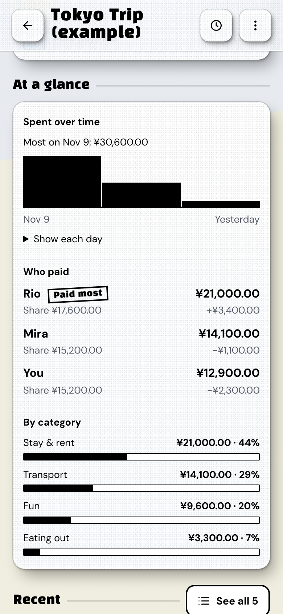

# HATI² (HATI_v2)

> **Handy All-round Transaction Interface, version 2.** Split trip and household expenses, see where the money went, settle up, and keep a volume in sync between phones with no account. An installable web app for Android and iPhone (also shipped as an Android APK), plus a native Android app.

-green?style=for-the-badge)


---

## Which app should I use?

| | Web app (`web/` → `docs/app/`) | Web app APK (`webapk/`) | Native Android app (`app/`) |
|---|---|---|---|
| Runs on | Android (Chrome) and iPhone (Safari), installed to the home screen | Android 8.0+ | Android 8.0+ |
| Install | Open the link, then **Install app** (Android) or **Share → Add to Home Screen** (iPhone) | Download `hati-web-apk` from the latest CI run on `main` (see [Get the APK](#get-the-apk)) | Build it (see setup) |
| Data | On the device, offline via a service worker | Same as the web app | Encrypted Room database (SQLCipher), biometric lock |
| Sharing | Invite link or QR, live end-to-end-encrypted sync, share code and backup file | Same as the web app | CSV / JSON export |

The web app and the web app APK are the same app and get every new feature; the native app is the older Compose version.

**Web app link:** `https://p1xellzxc.github.io/HATI_v2/app/` once GitHub Pages is enabled (Settings → Pages → Deploy from branch → `main`, folder `/docs`). The repository root of the site redirects to the app.

iPhone note: open the link in **Safari**, add it to the home screen **before** entering data, and always open it from the icon. The home-screen app keeps its own storage, separate from Safari.

---

## Screenshots (web app)

<p align="center">
  
  
  
  
  
</p>

Left to right: your volumes, a volume (balance, members, who pays whom), a new expense, At a glance, and dark mode with the Persimmon theme (Wada plate No. 338). Regenerate the full set with `web/shots.sh <dir>`.

Native Android captures and mockups live in `docs/screenshots/*.png` and `hub_final.png` (rendered by `tools/screenshots/render.js`).

---

## Features

**Everyday use**
- **Volumes** for each trip, household or event, with members, expenses and payments; archive or delete with undo.
- **Expenses:** amount, description, 12 categories with icons, date with one-tap Today / Yesterday, note. **Paste a receipt** and the total is filled in. Suggestions from past descriptions appear as you type. **Copy as new** for rent and bills.
- **Paid by** and **Members** as equal-width buttons that fill each row, for any number of people.
- **Splits:** equal, exact amounts, percent or shares. Money is kept in integer cents, so splits always add up exactly.
- **Who pays whom:** "fewest payments" or "pairwise", the same math as `CalculateDebtsUseCase.kt`.
- **Settle up** with suggested payments, the date paid and how (one tap for Cash, GCash or Bank).
- **Undo** after deleting or editing an expense or payment.

**Seeing where the money went**
- **At a glance** on every volume: spending over time (this month vs last for a household, day by day for a trip), who paid how much against their share, and the top categories.
- **History** grouped by month with each month's total; **search and filter** by words, person and category; **Set dates** to fix the date of many expenses at once.

**Sharing and safety**
- **Invite link or QR code:** the other person opens it on Android or iPhone, picks who they are and joins. No account.
- **Live sync:** changes show on the other phones within seconds; offline changes are queued and merged on reconnect. The server (Cloudflare Worker, `sync/`) only stores end-to-end-encrypted data; the key travels in the invite link.
- **Backup and restore** as one file; a share code as the offline fallback.

**Look**
- **Matte glass design** in **13 color themes** from Sanzo Wada's *A Dictionary of Color Combinations* (1918), light and dark, every text checked for WCAG contrast.
- **Offline first:** installable, works without a connection, no tracking.

**Native Android extras:** SQLCipher encryption (AES-256, key in the Android Keystore), biometric or PIN lock, CSV/JSON export.

---

## Design

Matte glass on calm paper (owner decision, November 2026):

- a calm two-tone page from the chosen theme, with nothing busy behind the glass;
- cards, buttons and sheets are matte glass panes: a fine grain, a lit top edge, a 1px edge, round corners and a soft shadow falling down and to the right;
- a chosen option sinks and inverts; text fields keep a visible edge;
- real blur only on the top bar and sheets, and none on low-end phones or with Reduce Transparency;
- numbered volume spines, ruled ledger lists, drawn line icons, and Black Han Sans with DM Sans as the typefaces.

Every text holds at least 4.5:1 contrast in all 13 themes, light and dark (`web/tests/contrast.js`). Design mocks, including the planned line chart for spending over time, are in `docs/mockups/`.

Full reference: [DESIGN.md](DESIGN.md). Themes: `app/src/main/java/com/hativ2/ui/theme/HatiPalette.kt`, which the web build also reads.

---

## Project layout

```text
app/                      Native Android app (Kotlin, Jetpack Compose)
  src/main/java/com/hativ2/
    data/                 Room + SQLCipher, DAOs, repositories, Keystore key manager
    domain/               Use cases (CalculateDebtsUseCase, exports), models
    ui/                   Compose screens, theme (HatiPalette.kt), components, auth gate
web/                      Web app source and tooling
  src/app.src.html        The whole web app (HTML, CSS, JS in one file)
  tools/build.py          Builds docs/app/ (palettes read from HatiPalette.kt)
  test.sh                 Build + serve + end-to-end suite (Playwright)
  shots.sh                Standard screenshot set (+ --contrast)
  tests/                  e2e.js, scenarios.md, contrast.js, pixel.js, shots.js
docs/app/                 Built web app (do not edit by hand)
.claude/skills/           Persona skills used by the AI team loop
sync/                     Live sync server (Cloudflare Worker + Durable Object, end-to-end-encrypted blobs)
webapk/                   Android wrapper that ships the web app as an APK
docs/mockups/             Design mocks (glass, minimal, charts)
brain/                    Obsidian vault: goal, roadmap, decisions, team log
```

---

## Setup

### Web app

```bash
git clone https://github.com/P1xellzxc/HATI_v2.git && cd HATI_v2
python3 -I web/tools/build.py          # builds docs/app/
web/test.sh /tmp/hati-test             # build, serve, run the e2e suite (needs Node + Playwright)
python3 -m http.server 8000 --directory docs/app   # then open http://localhost:8000
```

### Android app

Requirements: JDK 17 and Android Studio (or the Android SDK command-line tools).

```bash
./gradlew assembleDebug        # APK in app/build/outputs/apk/debug/
./gradlew lint test            # same checks as CI
```

Working toolchain (CI green since Nov 2026):

| AGP | Gradle | Kotlin | KSP | JDK | compileSdk / minSdk |
|---|---|---|---|---|---|
| 8.7.2 | 8.10.2 | 2.0.21 | 2.0.21-1.0.28 | 17 | 35 / 26 |

Libraries: Hilt 2.52, Room 2.6.1, Compose BOM 2025.01.01, core-ktx 1.15.0, lifecycle 2.8.7, activity-compose 1.10.0, navigation-compose 2.8.5, datastore 1.1.1, SQLCipher 4.14.1, biometric 1.1.0. These are the last versions known to build. Upgrades go one group at a time, each confirmed by CI.

---

## CI

`.github/workflows/ci.yml` runs on every push to `main` and on pull requests:

- **Lint + Unit Tests:** `./gradlew lint` and `./gradlew test`, including `HatiPaletteContrastTest`.
- **Instrumented Tests (API 34):** on an emulator.
- **Build Debug + Release APK** and the **web app APK** (`hati-web-apk`), signed with one fixed key so each build installs as an update.

The web app's end-to-end suite (`web/test.sh`: about 600 checks, text contrast, data in/out, receipt parser) runs locally before each merge; it is not in CI yet.

### Get the APK

1. Open [Actions → CI](https://github.com/P1xellzxc/HATI_v2/actions/workflows/ci.yml) and pick the latest green run on `main`.
2. Under **Artifacts**, download **`hati-web-apk`** (you need to be signed in to GitHub) and install the APK inside the zip.
3. It updates the installed app and keeps your data.

---

## How this project is developed

An AI team loop (plan → do → audit → revise) works toward one goal. The loop and its definition of done are in [web/README.md](web/README.md): the app installs on Android and iOS, handles real group use with correct money, and doesn't look AI-generated.

- **Skills:** each role is a skill in `.claude/skills/`: planner, designer, coder, code and design auditors, iOS, scenarios, money parity, copy, accessibility, motion, pixel perfectionist, ponytail review, sync, Android build, ship and goal judge.
- **Roadmap:** `brain/Roadmap.md` (next: restore keeps syncing, a fix for saving in the APK, a line chart per category with a moving average).
- **Decisions:** each decision goes to the skill that owns it and is recorded in `brain/Team log.md`.

---

## Obsidian (project brain)

The team's knowledge lives in `brain/` as an Obsidian vault: goal, decisions, team log, skills, design, themes and scenarios.

1. Clone the repo, then in the Obsidian app choose **Open folder as vault** and pick the `HATI_v2` folder. Code folders are hidden, and **HATI Brain** is bookmarked as the start page.
2. In Settings → Community plugins, turn off Restricted mode, browse for **Git** (by Vinzent) and install it. It pulls the team's latest notes on start and every 10 minutes.
3. Edit notes in `brain/`. To share your edits, use the Git plugin's *Commit-and-sync* command.

Derived notes are rebuilt by `python3 -I tools/brain/export.py`; `brain/Team log.md` is edited directly.

---

## License

MIT; see [LICENSE](LICENSE).
